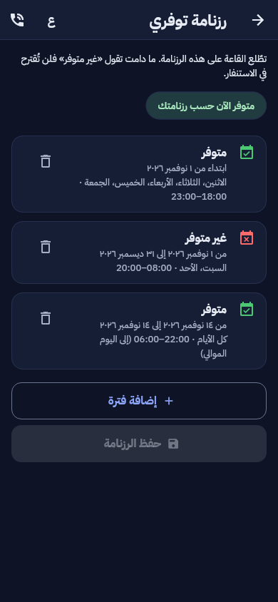

# المرحلة D: العرض أمام اللجنة والتطبيقات (المرحلة 3 من خطة المراحل الخمس)

طلبات يامن:

- 2026-10-30، حوصلة المراجعة (النقاط 1 إلى 28) ثم خطة المراحل الخمس: «انطلق في تنفيذ خطة المراحل الخمس… إلى حين
  الانتهاء الكامل».
- 2026-10-31، بعد دمج المرحلة F: «نعم واصل دون توقف بنفس الاحترافية».

## 1. الفكرة

تُعدّ هذه المرحلة المنظومة للعرض أمام اللجنة: حاسوب واحد وهاتفان دون إنترنت. وتسدّ ما بقي من نقاط المراجعة التي تخصّ
التطبيقين، مع ثلاث نقاط مؤجلة من المراحل السابقة (S2-5 و S2-1 و N-2).

| النقطة | ما تغيّر |
|---|---|
| 16 | العرض على حاسوب واحد: المنفذ 443 وحده، دون إنترنت، حساباته ومعطياته [SIM] ودليل تشغيله (`docs/demo.md`) |
| 25 | كاميرا المؤسسة: صاحبها يُنبَّه أولا، والقاعة بعد 90 ثانية دون جواب، مع ممرّ RTSP لكاميرا Tapo |
| 7 | التنبيه المستلَم: واتساب ونسخ الإحداثيات |
| 6 | رسالة الاستغاثة: ترتيب القنوات (SMS، واتساب، البريد) من الإعدادات، والبريد قناة جديدة |
| 3 | حمولة إشعار Firebase لا تحمل أي معطى شخصي، ويُرفض كل مفتاح غير مسموح |
| 18 | الأماكن الأقرب على خريطة دون اتصال، من النسخة المحفوظة في الهاتف |
| 17 | البث المباشر من تطبيق الأعوان، مربوطا بالمهمة والتدخل |
| 19 | الإملاء الصوتي في حقول النص الحرّ وحدها، والصوت يُمحى، وسجل التصحيحات لكل حقل |
| 21 | معرض وسائط موحّد في صفحة التدخل، مع سطر الخلاصة |
| 9 | ترتيب القائمة الرئيسية بالسحب والإفلات، يحفظه مدير النظام |
| S2-5 | المتطوع أو الطبيب يجيب على الاستنفار برسالة قصيرة موقّعة دون إنترنت |
| S2-1 | تفريغ الرسائل الصوتية للفريق، واقتراح أوقات المهمة منها |
| N-2 | لقطة شاشة رزنامة التوفر في تطبيق الهاتف |

## 2. التنبيه المسبق لصاحب الكاميرا (النقطة 25)

- كاميرا مؤسسة هي بثّ مباشر يحمل `org_id`، وفي ولاية المؤسسة نفسها (ترفض المنظومة غير ذلك).
- حين تؤكّد الرؤية الحاسوبية دخانا أو حريقا، لا يُزعج البلاغ القاعة فورا:
  - مديرو المؤسسة ومحرّروها يتلقّون إشعارا حرجا، ولهم مهلة `orgs.prealert_seconds` (90 ثانية افتراضيا، إعداد).
  - **«إنذار كاذب» مع السبب:** يُغلق التنبيه، ولا يصل شيء إلى القاعة، والسبب في سجل التدقيق.
  - **«تأكيد»:** يُنشأ البلاغ في الحال.
  - **دون جواب:** يرفعه العامل إلى القاعة عند انتهاء المهلة.
- البلاغ بلاغ `iot` عادي باسم المؤسسة وعنوانها، فيمرّ بالتجميع ودرجة الأولوية والمتابعة كبقية البلاغات. البثّ مربوط به،
  فترى القاعة الصورة الحية.
- **كاميرا Tapo:** ممرّ RTSP في MediaMTX (`infra/demo`) ينقل كاميرا الشبكة المحلية إلى المنظومة. دونها تعمل كاميرا
  المستودع [SIM].

## 3. العرض وتطبيق المواطن (النقاط 16 و 7 و 6 و 3 و 18)

- **العرض (16):** `scripts/demo.sh` (`up` و `users` و `seed` و `ca`) والملف `infra/demo/`. كل الأسماء
  `*.ehimaya.demo` على الحاسوب، وشهادة CA محلية للهاتفين. الإشعارات والرسائل القصيرة والبريد تمرّ بالمحاكيات. التفاصيل
  في [docs/demo.md](../demo.md).
- **التنبيه المستلَم (7):** زرّا «واتساب» و«نسخ الإحداثيات» تحت الخريطة، والنص بلغة المستعمل.
- **رسالة الاستغاثة (6):**
  - في الإعدادات ترتيب القنوات الثلاث بالسحب أو بالسهمين، وتعطيل ما لا يريده المستعمل.
  - بعد التنبيه داخل التطبيق تُفتح أول قناة لها مستلمون، وتبقى البقية أزرارا.
  - جهات الاتصال تقبل بريدا اختياريا (مخطط drift 3).
- **حمولة الإشعار (3):** `outbox` يرفض أي مفتاح خارج القائمة المسموح بها، وأي قيمة نصية حرّة. واختبار يمرّ على كل
  إشعار في الشيفرة.
- **الخريطة دون اتصال (18):** شاشة «على الخريطة» من «الأقرب إليّ»، تعرض أماكن الطبقات الظاهرة من النسخة المحفوظة
  (60 علامة لكل طبقة على الأكثر). العلامة تفتح الاتصال والمسار.

## 4. البث من تطبيق الأعوان (النقطة 17)

- `POST /api/v1/crew/missions/{id}/stream` يفتح بث WHIP للمهمة:
  - المصدر `crew`، وبث نشط واحد لكل مهمة، و WebRTC وحده.
  - عنوانه عنوان التدخل، ويظهر على الجدار وفي معرض التدخل.
  - المهمة المغلقة أو الملغاة ترفض (409 `mission_closed`).
- الموقع والإيقاف (`/crew/streams/{id}/location` و `/stop`) في سجل التدقيق. يفصل الإيقاف الناشر في MediaMTX.
- تطبيق الأعوان يعيد استعمال جلسة البث في تطبيق المواطن عبر `LiveStreamApi`، بزر «بث مباشر» في بطاقة المهمة.
- **الترحيل 0088:** العمودان `assignment_id` و `incident_id`، والقيد `ck_live_stream_crew`، والفهرس الفريد للبث النشط.

## 5. الإملاء الصوتي (النقطة 19)

- `POST /api/v1/staff/dictation?field=…&lang=`:
  - التسجيل يُفرَّغ في خدمة التفريغ المحلية (faster-whisper)، والصوت يُمحى في كل الأحوال.
  - 120 إملاء في الساعة لكل حساب.
- `POST /api/v1/staff/dictation/{id}/kept`: النص الذي أبقاه المستعمل يُرسل مرة واحدة عند إرسال النموذج. يُحسب عدد
  الكلمات والأخطاء ونسبة الخطأ (WER).
- **سجل التصحيحات:** `GET /api/v1/staff/dictation` لمسؤول الذكاء الاصطناعي، بنسبة الخطأ لكل حقل.
- **في اللوحة:** `DictatedTextarea` في حقول النص الحرّ وحدها: نص البلاغ المُدخَل في القاعة، وملاحظة البلاغ، ونص
  التوجيه والرد. لا إملاء في رقم ولا تاريخ ولا اختيار ولا اسم.
- **الجدول `ai.dictation`:** النص المفرَّغ والنص المُبقى مشفّران.

## 6. معرض وسائط التدخل (النقطة 21)

- `GET /api/v1/staff/incidents/{id}/media` يجمع، بترتيب الوقت (آخر 300):
  - وسائط المواطنين.
  - صور الفرق ورسائلها الصوتية بتفريغها.
  - إطارات الرؤية الحاسوبية، وتسجيلات البث.
  - البثوث، الجارية والمنتهية.
- تسجيلات المكالمات تبقى في صفحة المكالمة بقواعدها. فتح المعرض في سجل التدقيق.
- **في اللوحة:** سطر الخلاصة («صور: 12 · فيديو: 2 · رسائل صوتية: 3 · بث جارٍ: 1») ثم المعرض، قبل الخريطة في صفحة
  التدخل.

## 7. ترتيب القائمة (النقطة 9)

- الإعداد `menu.order` يحفظه مدير النظام:
  - يحمل ترتيب المجموعات وترتيب الروابط في كل مجموعة.
  - تُرفض المجموعة المجهولة، والتكرار، والمسار غير الداخلي.
- **صفحة «ترتيب القائمة» (`/settings/menu`):**
  - سحب وإفلات، وسهمان لمن لا يستعمل الفأرة.
  - سبب التغيير إلزامي.
  - لغير مدير النظام القراءة فقط.
- القائمة الجانبية تتبع الترتيب المحفوظ:
  - ما لم يُذكر يبقى في مكانه بعد المذكور.
  - الترتيب لا يمنح صلاحية: الرابط الذي لا يحقّ للحساب لا يظهر.

## 8. الإجابة على الاستنفار برسالة قصيرة (S2-5)

- دون إنترنت يفتح التطبيق تطبيق الرسائل برسالة جاهزة إلى رقم المنظومة، وهو الرقم نفسه لبلاغات `EH1` وخطوات الفرق
  `EH2`، ويضغط المتطوع «إرسال».
- **الصيغة:** `EH3 <المتطوع> <الاستنفار> <accept|decline|arrived> <دقائق الوصول> <الوقت> <التوقيع>`، وهي «قبلت» مع
  دقائق الوصول، و«أعتذر»، و«وصلت».
- **التوقيع:** أول 16 رقما من HMAC-SHA256 بمفتاح المتطوع نفسه.
  - المفتاح يُطلب مرة واحدة والهاتف متصل (`POST /api/v1/me/volunteer/sms-key`)، للمتطوع المعتمد وحده.
  - المفتاح محفوظ مشفّرا في الجانبين.
- **ما يُتجاهل:** التوقيع الخاطئ، والرسالة الأقدم من 12 ساعة، وغير الأحدث من آخر رسالة طُبّقت (منع الإعادة). لا
  يُعاد شيء إلى البوابة.
- الرسالة تُطبَّق كجواب التطبيق تماما، وتُسجَّل `volunteer.sms_accept` أو `sms_decline` أو `sms_arrived`.

## 9. الرسائل الصوتية للفريق وأوقات المهمة (S2-1)

- حين تطلب القاعة الأوقات المقترحة لسجل المهمة، تُفرَّغ أولا الرسائل الصوتية للفريق التي لم تُقرأ بعد:
  - خدمة التفريغ المحلية، مع مفردات المحضر الميداني.
  - مرة واحدة لكل رسالة، وثماني رسائل على الأكثر في الطلب.
- التفريغ محفوظ مشفّرا بجانب الصوت. الصوت يبقى لأنه دليل الفريق في معرض التدخل.
- الأوقات المقروءة منه تظهر بمصدر «رسالة صوتية للفريق»، ولا يُطبَّق شيء إلا بضغطة من المشغّل.
- **دون خدمة التفريغ:** لا تُقرأ الرسائل، وتعمل القواعد على البقية. الرسالة التي لا تُفكّ تُعلَّم مقروءة دون نص.
- **الترحيل 0088:** سياسة `field_attachment_update` لأمن مستوى الصفوف. القاعة تكتب التفريغ في تدخلات ولايتها فقط.

## 10. رزنامة التوفر في الهاتف (N-2)

| فاتح | داكن |
|---|---|
|  |  |

مأخوذة من الشاشة الحقيقية بخطّ IBM Plex Sans Arabic، بثلاث فترات: متوفر مساء أيام العمل، وغير متوفر في نهاية الأسبوع،
وليلة واحدة تمتدّ إلى اليوم الموالي.

## 11. الترحيل 0088

| الجدول | ما أُضيف |
|---|---|
| `reports.live_stream` | `org_id` (كاميرا المؤسسة)، و `assignment_id` و `incident_id` والمصدر `crew` |
| `org.prealert` | ما رأته الكاميرا، وجواب صاحبها في المهلة، والبلاغ الذي صار إليه |
| `ai.dictation` | الإملاء: الحقل، والنص المفرَّغ، والنص المُبقى (مشفّران)، ونسبة الخطأ |
| `identity.volunteer` | `sms_key_enc` و `sms_last_at` |
| `ops.field_attachment` | `transcript_enc` و `transcribed_at`، وسياسة التحديث |

- `alembic downgrade 0087_field_agents` يعيد القاعدة كما كانت.
- الإعدادان الجديدان: `orgs.prealert_seconds` (90) و `menu.order`.

## 12. المتطلبات

| المعرّف | المتطلب | الحالة |
|---|---|---|
| FR-D-01 | العرض على حاسوب واحد دون إنترنت، بمعطيات [SIM] ودليل تشغيل | منجز |
| FR-D-02 | تنبيه صاحب الكاميرا أولا، والقاعة بعد المهلة دون جواب، والإنذار الكاذب لا يصل القاعة | منجز |
| FR-D-03 | واتساب ونسخ الإحداثيات من التنبيه المستلَم | منجز |
| FR-D-04 | ترتيب قنوات الاستغاثة من الإعدادات، والبريد قناة | منجز |
| FR-D-05 | لا معطى شخصيا في حمولة الإشعار | منجز |
| FR-D-06 | الأماكن الأقرب على خريطة دون اتصال | منجز |
| FR-D-07 | البث المباشر من تطبيق الأعوان مربوطا بالمهمة | منجز |
| FR-D-08 | الإملاء في حقول النص الحرّ، والصوت يُمحى، وسجل التصحيحات | منجز |
| FR-D-09 | معرض وسائط موحّد مع سطر الخلاصة | منجز |
| FR-D-10 | ترتيب القائمة بالسحب يحفظه مدير النظام | منجز |
| FR-D-11 | الإجابة على الاستنفار برسالة قصيرة موقّعة دون إنترنت | منجز |
| FR-D-12 | تفريغ الرسائل الصوتية للفريق واقتراح أوقات المهمة منها | منجز |

## 13. الاختبارات

- **الواجهة البرمجية (`test_phase_d.py`، 15 اختبارا):**
  - التنبيه المسبق: الولاية، والإنذار الكاذب، والتأكيد، والمهلة، والإعداد.
  - حمولة الإشعار.
  - بذرة العرض.
  - بث الفريق.
  - الإملاء.
  - المعرض.
  - ترتيب القائمة.
  - رسالة `EH3`.
  - الرسائل الصوتية للفريق.
- **لوحة القيادة:** `Dictation.test.tsx`، و`IncidentGallery.test.tsx`، و`MenuOrderPage.test.tsx`، و`streams`.
- **التطبيق:**
  - `staff_live_test.dart`: بث الفريق.
  - `places_test.dart`: الخريطة دون اتصال.
  - `safety_flow_test.dart` و`safety_test.dart`: القنوات والبريد.
  - `phase5_flow_test.dart`: رسالة `EH3`، ومتّجه التوقيع نفسه في الخادم.
