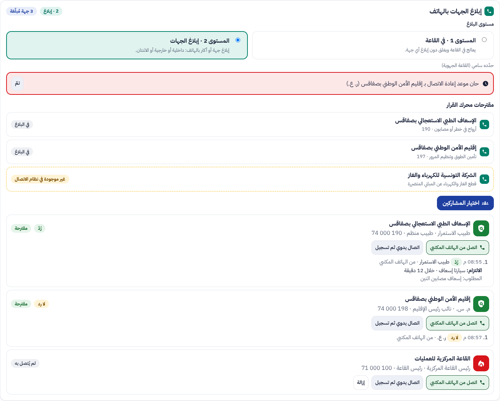
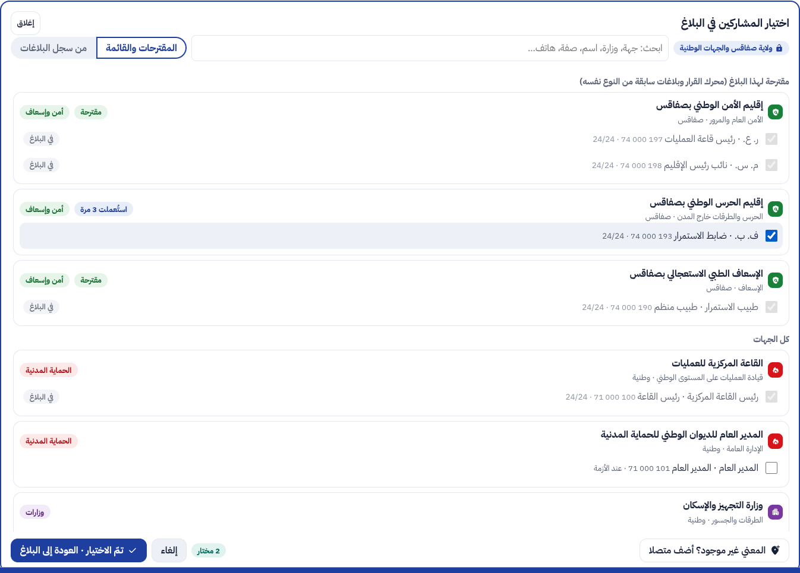
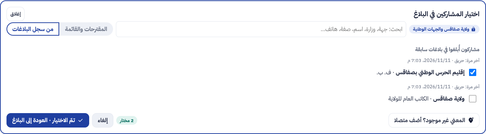
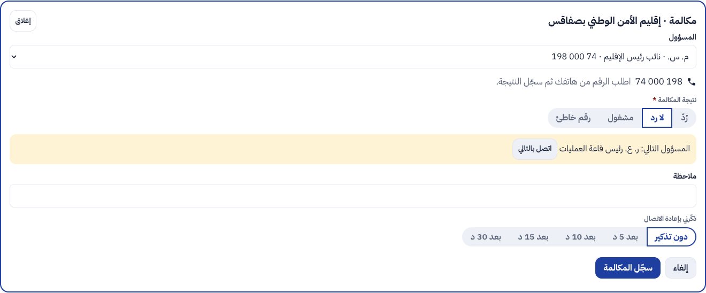
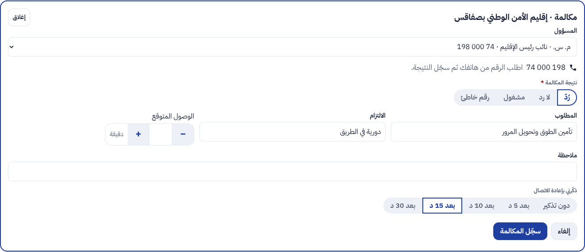
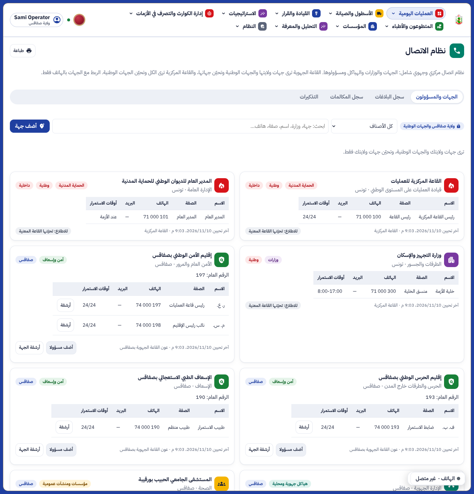
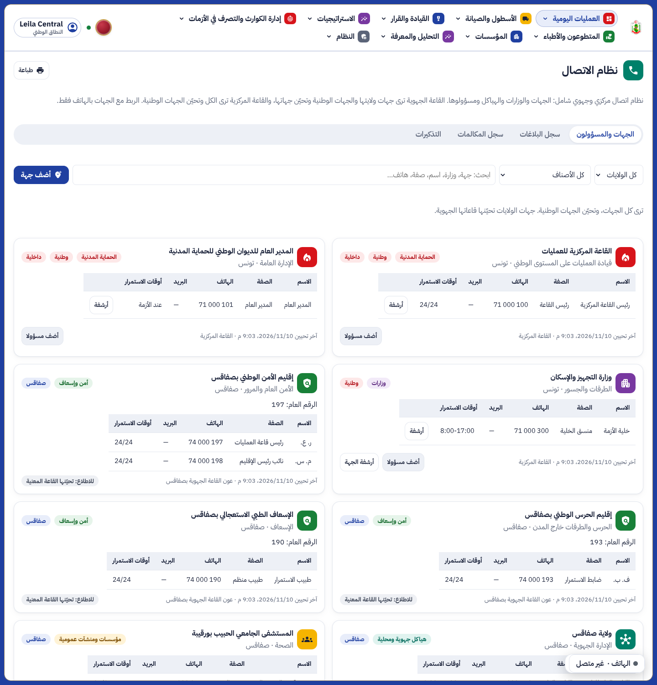
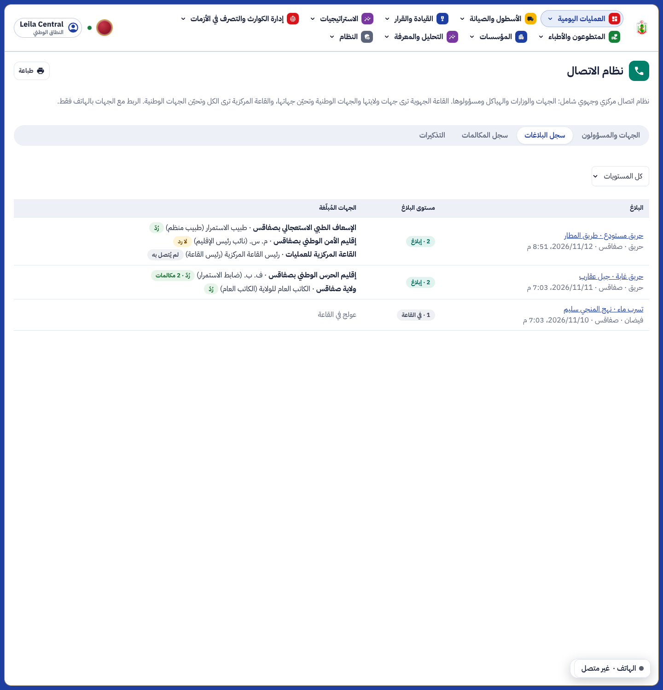
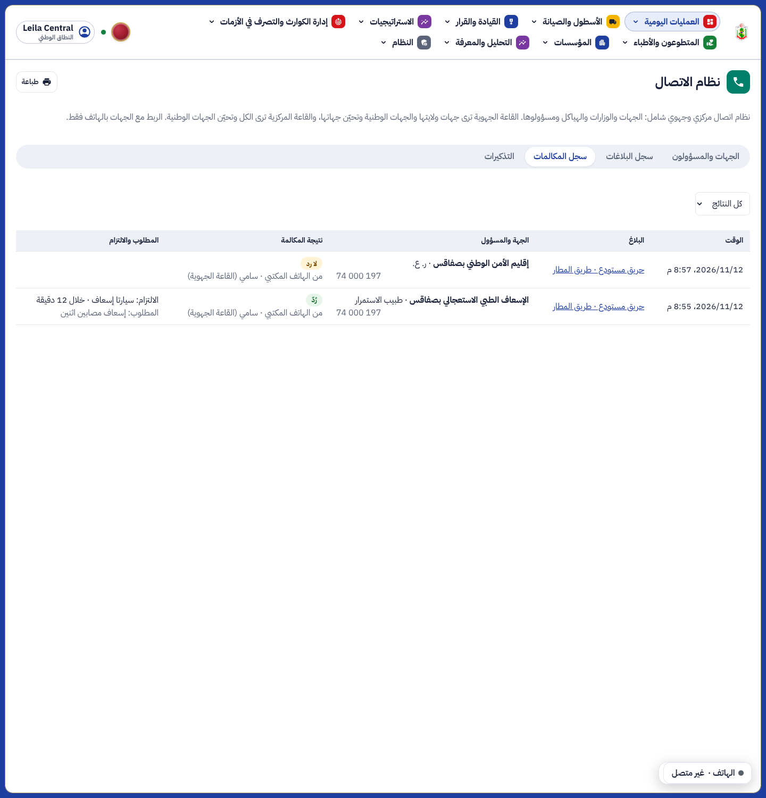

# OS20: informing the partner bodies by phone

Source: idea OS20 of the open-source study, prototyped in isolation (`/mnt/project-files/prototypes/partner-exchange/`,
screens 01 to 23) and shaped by Yamen's answers of 2026-11-12: two levels of a report, a central and regional contact
system rather than a directory, the bodies reached by phone only («الترابط بين الجهات لا يتم إلا عن طريق الهاتف»), the
bodies informed kept in the report's history, and a picker that starts from the suggestions, searches the whole system
or picks from the history, several at once, then returns to the report. Final go-ahead: «لديك التفويض لهذا الخيط نفذ».
The version before this work is kept on the branch `backup/pre-partner-exchange-2026-11-12` and in the bundle
`backups/repo/e-himaya-pre-partner-exchange-2026-11-12.bundle` of the project files.

## 1. What changes and what stays

- New: the level of a report, the contact system (`/liaison`), the bodies informed of a report with the record of each
  call, the reminders to call back, the history of the reports with their bodies, the log of the calls.
- Unchanged: the report, its priority, the dispatch, the decision engine (its agency rules are reused as they are), the
  softphone (a call to a body goes through the same `POST /api/v1/staff/calls/dial`).
- Left out (parked in the backlog, X3): an API or webhooks with the bodies, an SMS link, automatic receipt. Most bodies
  have no system; the phone is the link.

## 2. The level of a report

| Level | Meaning |
|---|---|
| 1 · in the room | Handled in the room and closed without informing anyone. No body can then be added. |
| 2 · inform | One or more bodies are informed by phone: internal (head of the central room, Director General), external (190, 193, 197, STEG, forests …) or both. |

`PUT /api/v1/staff/liaison/incidents/{id}/level`. Adding a body sets level 2 when no level was set. Once a body is
informed, level 1 is refused (`409 parties_informed`).

## 3. The suggestions

The decision engine's agency rules (`decision.responders.agencies`: lives at risk → SAMU; the incident's type and
classification → police, garde nationale, STEG, SONEDE, forests …; gas → STEG). Internal bodies: the central room when
the operational level is not normal or the priority is 80 or more; the Director General when the level is crisis or
disaster. Each suggestion is matched with the body of the contact system that carries the same `agency` in the
incident's gouvernorat, else the national one; when none exists it is shown «غير موجودة في نظام الاتصال» with its public
number, and the agent adds it.

## 4. The picker

One panel in the report (the dashboard has no modal dialogs):

- the central room chooses the gouvernorat first (the national bodies are always listed); a regional room is fixed to
  its gouvernorat and the national bodies;
- «المقترحات والقائمة»: the suggested bodies and those informed in earlier reports of the same kind first, then every
  body. The search box filters the list and puts the matches at the top, with the words highlighted (body, field,
  address, official, role, phone);
- «من سجل البلاغات»: the bodies informed in earlier reports, each with the report it was last used in;
- several officials ticked at once; «تمّ الاختيار · العودة إلى البلاغ» adds them and returns to the report;
- «المعني غير موجود؟ أضف متصلا»: a new body with its first official, or a new official of a body the room keeps.

## 5. The call

From the softphone (the room's registered phone dials the official's number) or by hand. The agent records the result
(answered, no answer, busy, wrong number), what was asked, what was promised, the expected arrival (a stepper), a note
and a reminder to call back in 5, 10, 15 or 30 minutes. On no answer or busy the next official of the body in calling
order is offered. A call to another official makes them the party's official. The reminders show in the report, red
once due, and on the «التذكيرات» tab.

## 6. The contact system

A body: category (civil protection, security and rescue, ministries, regional and local structures, public
institutions), internal or external, field of activity, address and place, public number, status, last update and by
whom. Its officials: name, role, phones (up to 4), email, duty hours, calling order.

| | Reads | Keeps (adds, updates, archives) |
|---|---|---|
| Regional room | its gouvernorat and the national bodies | its gouvernorat's bodies |
| Central room | every body | the national bodies; from a report, it may add a missing body of the report's gouvernorat, which the regional room keeps from then on |

The two internal national bodies (central room, Director General) are seeded without officials and are never archived;
no personal number is seeded. A version number guards concurrent edits (`409 version_conflict`).

## 7. Rights

| Action | Who | Button |
|---|---|---|
| Read the contact system, a report's bodies and calls, the history, the log, the reminders | the operations read roles | page `liaison` |
| Add and update bodies and officials | operator, ops_manager (the owning room) | `liaison.contacts` |
| Set the level, add and remove bodies, record calls, close reminders | operator, ops_manager | `liaison.inform` |

## 8. Data

Migration `0106_liaison`, schema `liaison`:

- `body`, `official`: row-level security, read = national or own gouvernorat (central: all), write = own gouvernorat
  (central: all, the app keeps edits to the owning room). The official's gouvernorat is copied from its body by a
  trigger. One active body per `agency` and gouvernorat.
- `incident_level`, `party`, `call`: follow the report's gouvernorat. Party and call keep the names as they were, so the
  history reads the same after the contact system changes. A party once called is never removed (`409 party_called`).
- Change journal attached to every table; officials and calls keep no values (names, phones, notes).

API: `/api/v1/staff/liaison` (`bodies`, `officials`, `incidents/{id}`, `incidents/{id}/level`, `incidents/{id}/picker`,
`incidents/{id}/parties`, `…/parties/{pid}/calls`, `follow-ups`, `calls`, `history`).

## 9. Screens

| | |
|---|---|
|  | The report: level 2, the engine's suggestions (STEG missing), the bodies informed and their calls, a reminder due |
|  | The picker: suggested and used before first, two officials ticked |
|  | The picker: from the history of the reports |
|  | No answer: the next official offered |
|  | Answered: asked, promised, expected arrival, reminder |
|  | The contact system of the Sfax room: its bodies and the national ones (read only) |
|  | The contact system of the central room |
|  | The history of the reports with the bodies informed |
|  | The log of the calls |
